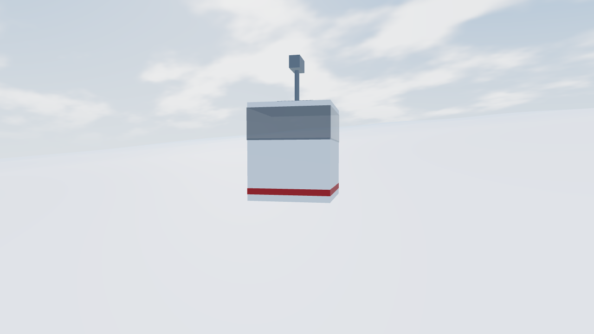
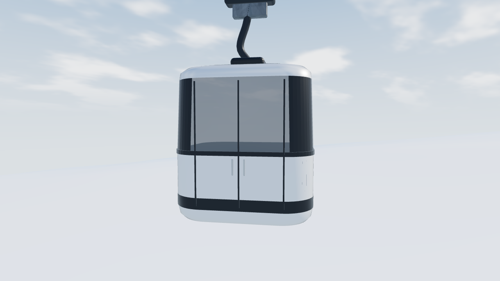
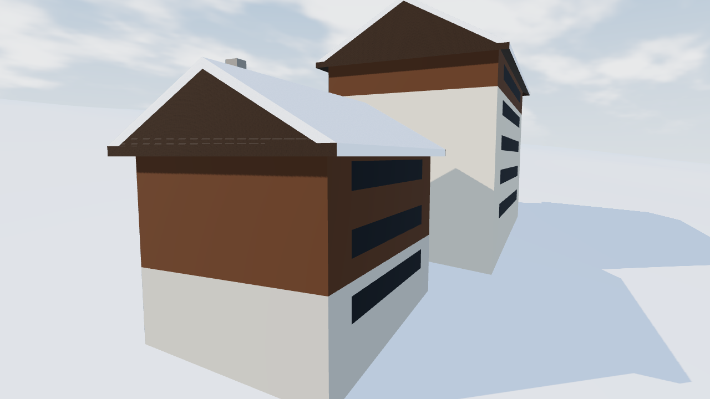
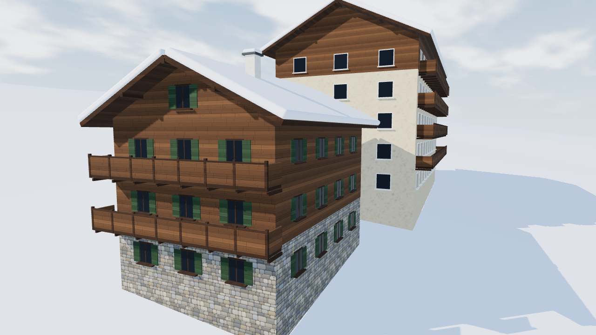

# EVADER 1.3: free ride that holds together, and lifts and villages that look the part

This release answers three complaints about 1.2:
- the houses, gondolas and chairlifts looked embarrassing;
- free ride was not really free;
- free ride bugged out.

## Free ride: what was breaking, and the fixes

I wrote a stress harness, `tools/dev/freeride-stress.mjs`. Bots ride, carve, brake, skate and walk for two minutes from each of ten stations, and every crash, ground penetration, blow-up and stuck state is logged. It found:

| Problem | Cause | Fix |
| --- | --- | --- |
| Invisible steps and walls off-piste | Where a 2 m tile had no loaded neighbour, the ground switched straight to the 10 m overview: steps of 1.7 m typically, 8 m in 1 % of places, up to 25 m. 163 of the 361 km² have no 2 m data at all. | Tiles now fade into the overview over 150 m toward any edge without a neighbour. Measured step at an edge: 0.00 m. |
| The ground shifting under the rider | Tiles streamed in while you rode changed the height under you by up to several metres. | In free ride, a fetched tile waits until you are at least 120 m clear of it and its seam; the scenery on it is rebuilt then. |
| Numeric blow-ups (NaN, rider launched) | A new slow-contact push moved the board sideways without following the slope. It was caught by the harness before release. | The push now follows the ground, a few cm per tick. |
| Crashing into a tree or wall at walking pace | Every contact was a full crash. | Below 16 km/h, trees, rocks, walls and towers stop you and you slide along them. Faster, you still fall. |
| Stuck on flats and behind buildings | Nothing could move you uphill; skating stops at 5 m/s. | Walking (below). |
| Starting inside a station | Free ride started at the station's centre point, which is inside the new terminal buildings. | You start at the nearest clear spot beside the station: away from lift terminals and buildings, on ground no steeper than 35°, still within reach of its lifts. |
| The camera inside buildings | The chase camera could swing into walls in villages. | If it would end up inside a building or tower, it slides in toward the rider until it is outside. |
| Slower and heavier over a long session | The replay recorded 60 frames/s for the whole session (about 216,000 snapshots per hour). The forest and piste poles were rebuilt every 120–350 m with new GPU buffers that were never freed. | Free ride keeps the last two minutes for its replay, and rebuilt groups free their buffers. |

## Free ride is free

- **Walk anywhere.** Below 9 km/h, hold W (on a phone, tilt forward). The rider unclips the back foot and walks or skates the board in any direction, uphill too: about 2 m/s on the flat, slower the steeper it gets, and nothing up a cliff. A and D turn. Let go and you ride on from where you are. A hint appears when you have been stopped for a few seconds.
- **Drop in anywhere.** On the resort map (2D or 3D), tap any spot that is not a lift, station or piste. A pin marks it, with its height and the nearest station, and **Free ride from this spot** starts you there.
- **Tested:** walking from the flat Siviez station, walking uphill at Les Ruinettes, and three two-minute stress rides without blow-ups, in `tests/verbier.mjs`.

## Lifts, rebuilt

Shared toolkit: `lib/verbier/craft.ts`. Rounded and lofted shapes, bent tubes, procedural textures (galvanised steel, larch, stone, plaster, fabric, concrete) at world scale, and PBR materials with clear-coated cabin paint and reflective glass.

- **Chairs:**
  - detachable grip with rollers;
  - bent-tube hanger and frame;
  - padded fabric seats and backrests with armrests;
  - a safety bar with a rubber footrest;
  - a tinted weather bubble on lifts mapped with one.
- **Gondola cabins:**
  - a rounded shell;
  - a continuous glass band with corner pillars;
  - sliding-door seams and handles;
  - a domed roof with a fairing;
  - benches inside, visible through the glass.
- **Aerial tramways:**
  - a large glazed cabin with a roof deck and railing;
  - an A-frame hanger;
  - a carriage running on 16 wheels.
- **Towers:**
  - concrete footing;
  - tapered galvanised column with a ladder;
  - braced crossarm with a catwalk and railing;
  - rubber-lined sheave trains on rocking beams, with rope catchers;
  - ropes are now steel tubes.
- **Stations:**
  - concrete platform and loading lane with railings;
  - steel columns and a long terminal hood with a dark underside;
  - bullwheel, grip rails, and glazed walls for gondolas;
  - an operator cabin;
  - a larch-clad machine house with a snowy roof.
- **Level of detail:** towers within about 420 m (High) or 260 m (Balanced) are full detail; farther ones are simple silhouettes. Lifts are rebuilt as you move.

All designs are generic: no manufacturer's model, livery or branding.

## Buildings, rebuilt

The same 10,758 real footprints, now drawn as Valais buildings:
- **Chalets:**
  - a stone ground floor with larch planks above;
  - windows with frames, sills and shutters, mostly wood, some painted green or red;
  - balconies with posts on each upper floor of the valley-side gable;
  - deep gable roofs under thick snow, with purlin ends;
  - chimneys, and a door on the uphill side.
- **Apartment blocks and hotels:** plaster floors, a timber top floor and balconies along the long side.
- **Others:** barns on stone bases, plaster or concrete halls, and churches with a bell tower and spire.

Three levels of detail by distance:
- near (210 m on High, 130 m on Balanced): the full model;
- middle (800 m / 600 m): windows, balconies and chimneys;
- far: one block and a snowy roof.

## Cost, measured in the densest spot (Verbier – Médran)

| Quality | Building triangles | Lift structures | Lift vehicles |
| --- | --- | --- | --- |
| High | 534,000 | 162,000 | 121,000 |
| Balanced | 291,000 | 153,000 | 100,000 |
| Low | 108,000 | 85,000 | none parked |

Vehicles on other lifts use the full model within 150 m (High) or 90 m (Balanced), and a cheap silhouette beyond. Measured whole models: a 6-seat chair is about 3,400 triangles, a gondola cabin about 3,200, a tram about 5,500.

Measure it yourself with `node --experimental-strip-types tools/dev/tricount.mjs "<station>" <quality>`.

## New developer tools

- `tools/dev/viewer/`: a close-up model viewer using the game's own sky, sun and tone mapping.
  - `node tools/dev/viewer/server.mjs` serves it, stripping types from `lib/*.ts` on the fly.
  - `node tools/dev/viewer/shoot.mjs <dir>` screenshots every model.
- `tools/dev/freeride-stress.mjs`: the free-ride stress harness.
- `tools/dev/tricount.mjs`: triangle and draw-call counts.

## Screenshots (software renderer)

| Before | After |
| --- | --- |
|  |  |
|  |  |

More in `docs/screenshots/v13/`:
- in-game views: a gondola ride over Verbier, boarding the Attelas chair, the start beside the station;
- model close-ups: chair, tram, tower, gondola station, village.

## Still true

- **Real GPU:** nothing has been measured on one yet. Every picture comes from a software renderer. The benchmark (`?bench`) is still the way to measure your machine.
- **Building shapes:** footprints are generalised rectangles, so L-shaped and complex buildings are simplified. Window positions, balconies and colours are typical, not surveyed.
- **Station buildings:** lift stations are generic terminals, not the real Verbier architecture.
