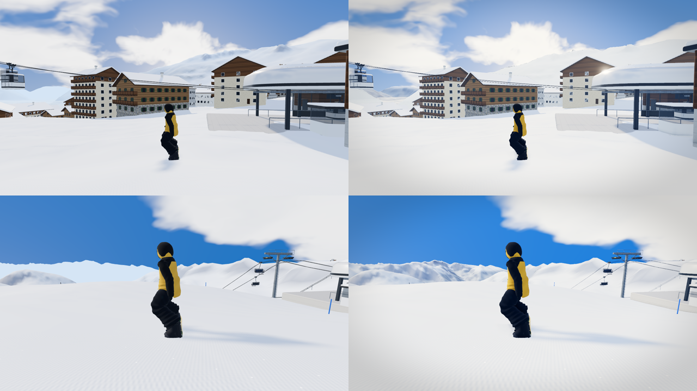

# EVADER 1.4: a cinematic image for strong PCs

1.4 is about making EVADER look the part on a powerful PC.

The look is built with standard real-time rendering techniques, tuned for bright alpine snow. No art, models, levels, characters, interface or branding come from any other game.

## The cinematic image

The new pipeline is in `lib/postfx.ts`. It is on by default for **High** and above; switch it off in Settings › Graphics › **Cinematic image**. On desktop, EVADER already starts on Extreme, so a strong PC gets it straight away.

1. **4× multisampled HDR rendering** (8× on Cinematic), with a depth buffer.
2. **Height haze with aerial perspective.**
   - The haze is integrated along every view ray: thick in the valleys around 1,500 m, thinning toward the summits. Distant ranges fade toward the horizon colour, and the haze glows toward the sun.
   - It replaces the old flat distance fog. It needs no per-material changes, since it reads the depth buffer.
3. **Ground-truth ambient occlusion** (Ultra, Extreme and Cinematic). It shades where things meet the snow: boots, trees, chalets, lift towers, station columns.
4. **Bloom on true highlights only:** the sun, ice glints and hot specular.
   - The threshold sits above the brightness of sunlit snow; a lower threshold made the whole snowfield glow and turned the image milky, which the in-game test caught.
5. **Filmic tone mapping** at a high-key exposure, 1.3 instead of 1.15, for near-white snow.
6. **A display-space grade:** a gentle S-curve, cool blue in the shadows, faintly warm sunlit highlights, and a light vignette.

## Also in every preset

- **Sky.** Domain-warped cumulus with crisp edges, self-shadowing toward the sun, silver linings and a bright haze band at the horizon. The old cloud noise used a `sin()` hash that collapses on GPUs at large coordinates, so its fine detail was missing; it now uses an arithmetic hash.
- **Snow surface.**
  - Wind drifts are irregular value noise stretched along the wind, replacing rows of sine waves.
  - Groomer corduroy and grain fade out before they are finer than a pixel. Before, they produced moiré rings 5–30 m in front of the rider.
- **Forest.** Spruces rebuilt as full, snow-loaded trees, about 0.4 times as wide as they are tall, from stacked drooping branch skirts with jagged tips. Snow lies on some branches, with dark needles at the tips and underneath. The triangle budget is about the same as before.

## For tuning the look

`tools/dev/viewer/free.html` renders the real Verbier world around any station, with the rider, using the game's sky, sun and tone mapping, with or without the pipeline:

```bash
node tools/dev/viewer/shoot.mjs <out dir> "world:s35,fx,cam=far" "world:s12,cam=low"
```

Hash options:
- a station id;
- `fx` or `fx-cinematic`;
- `cam=behind|side|low|far`;
- `exp=<exposure>`, `tm=agx`, `den=<haze density>`.

## Screenshots (software renderer, so slower and blurrier than a real GPU)



The left column is without the pipeline and the right column with it; both include the new sky, trees and snow.

More in `docs/screenshots/v14/`:
- Ultra in the game;
- the haze up the Attelas valley;
- Médran;
- the new forest.

## Not done, honestly

- **Real GPU:** nothing was measured on one. Ambient occlusion re-renders the scene's normals and depth, so it costs real GPU time. Expect Ultra with the cinematic image to need a strong graphics card at 1440p or 4K.
- **Measuring your machine:** run the benchmark (`?bench`) with the cinematic image on and off.
- **Not added:** volumetric clouds, screen-space reflections and depth of field.
- **Characters:** the rider and other skiers are unchanged; they are still the procedural models.
